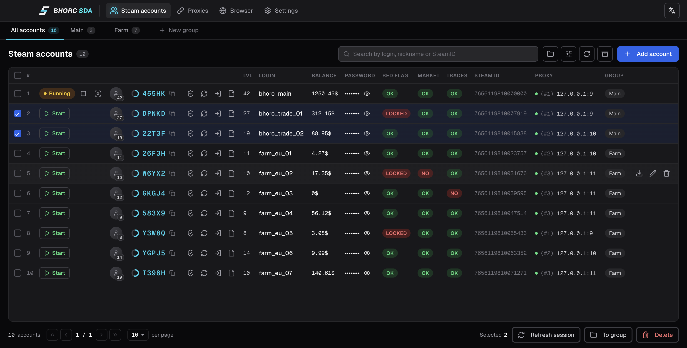
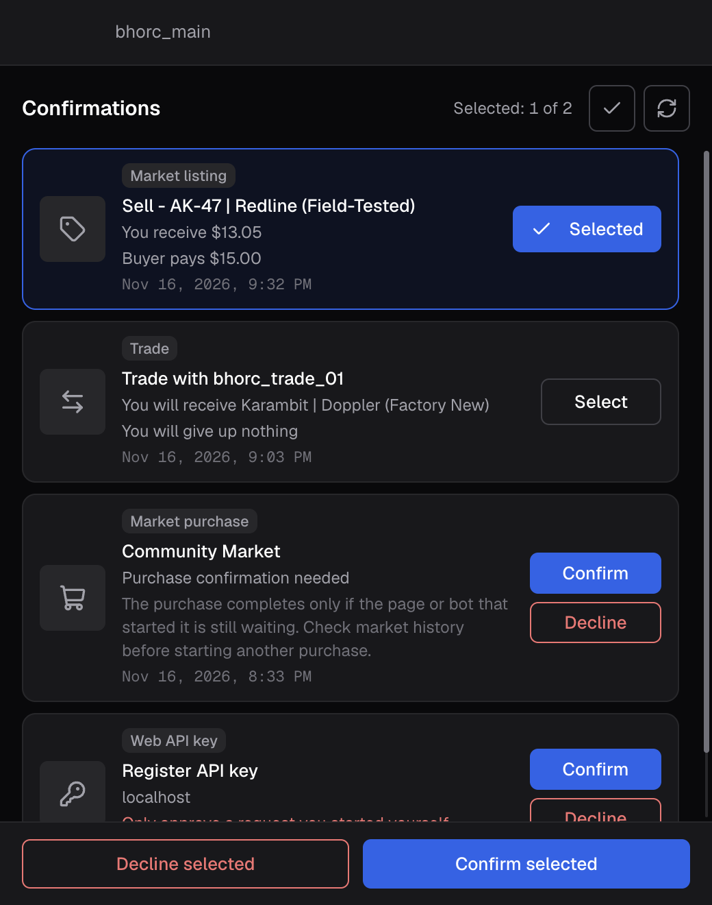
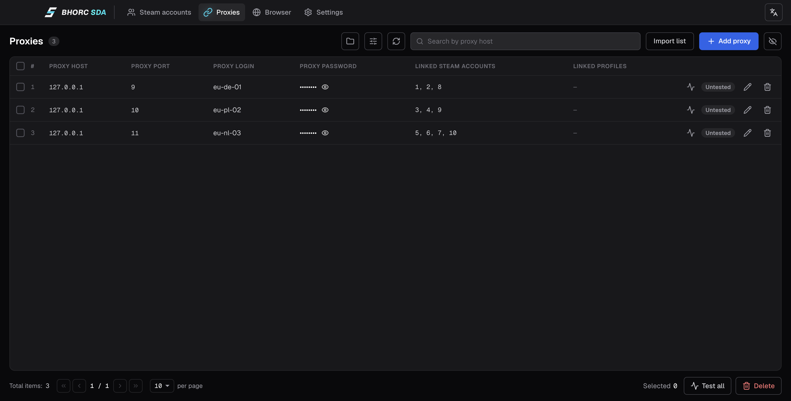
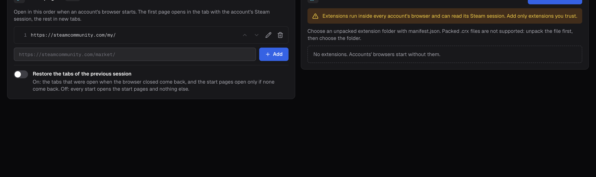

# BHORC SDA

An open-source desktop app for running many Steam accounts from one window: Steam Guard codes, confirmations, a proxy for every account and a separate browser for every account.



## What it does

- **Steam Guard for many accounts.** Codes, trade and market confirmations, maFile import and export, account groups.
- **Confirmations for everything Steam asks about now:** trades, market listings, market purchases, API keys. Purchases, API keys and account security changes are confirmed one at a time; an API key only after a warning.
- **A proxy for every account.** All Steam traffic of an account goes through its proxy. If that proxy is gone, the account stays offline instead of quietly using your own address.
- **A browser for every account.** Each account gets its own Chromium profile, already signed in, on the account's proxy, with the time zone and language of the proxy's country. Start pages and extensions are set once for all of them.
- **Status at a glance:** level, wallet balance, red flag, market and trade restrictions. When a check has not run or has failed the table says "unknown" instead of "OK".
- **Runs in the background:** optional tray icon and launch at system startup.
- English, Ukrainian and Russian interface.

| Confirmations | Proxies | Browser settings |
| --- | --- | --- |
|  |  |  |

## Why this one

- **Your address stays yours.** Account traffic never falls back to a direct connection, the app's own windows cannot reach the network at all, and DNS-over-HTTPS is turned off because it would bypass a proxy. See [Privacy](#privacy).
- **Nothing phones home.** No telemetry, analytics, crash reports, licence or update checks. There is no server of ours.
- **Open code under MIT.** Every claim on this page can be checked in the source and in the tests next to it.
- **Built for a farm, not for one account:** groups, bulk proxy import, one click to refresh sessions, a table you can sort and trim to the columns you need.

## Download

Installers are on [GitHub Releases](https://github.com/BHORC-Trading-CO/bhorc-sda/releases), with a changelog and SHA-256 sums.

| System | File | Status |
| --- | --- | --- |
| Windows 10 and 11, x64 | `BHORC-SDA-…-windows-x64-Setup.exe` | Supported |
| macOS on Apple Silicon | `BHORC-SDA-…-macos-arm64.zip` | Supported |
| macOS on Intel | build from source | Not tested |
| Linux | — | Not yet: the code does not build on a case-sensitive file system. Planned. |

The builds are not code-signed, so the system will warn on first start:

- **Windows:** SmartScreen shows "Windows protected your PC". Choose "More info", then "Run anyway".
- **macOS:** unpack the archive, move `BHORC SDA.app` to Applications and remove the download flag once:

  ```sh
  xattr -dr com.apple.quarantine "/Applications/BHORC SDA.app"
  ```

Compare the SHA-256 sum of the file with the one published next to it before you run it.

## Privacy

BHORC SDA has no server of ours behind it. It does not collect your data and does not send it to us or to anyone else: there is no telemetry, analytics, crash reporting, licence check or update check in the code.

What the app does send, and where:

- Requests to Steam for an account go through that account's proxy. An account whose linked proxy is missing stays offline.
- The app's own windows have no network access. Avatars and item icons are fetched by the main process through the account's proxy.
- Chromium for account browsers is downloaded from Google's public snapshot storage, from your own address, when the build does not already contain it. The request carries nothing about your accounts.
- DNS-over-HTTPS is off, in the app and in every account browser.

How this was checked: the code went through a security audit before it was opened; outgoing connections were reviewed with Claude Code, an AI coding assistant, and measured on running builds by listing the connections of the app's processes. What was found was fixed, and each rule above has automated tests next to the code it covers.

What this does not cover:

- Steam and your proxy provider see what they would see from any Steam client.
- Extensions you add to account browsers can read the sessions in those browsers. Add only ones you trust.
- Data on disk is not encrypted, see [Where data lives](#where-data-lives).

The code is open so that you do not have to take our word for any of this.

## Community and support

- News and discussion: [t.me/BHORC_Trade](https://t.me/BHORC_Trade)
- Bugs and ideas: [GitHub Issues](https://github.com/BHORC-Trading-CO/bhorc-sda/issues). Never attach maFiles, passwords, `config.json` or anything from the data folder.

## Status

Beta. See [CHANGELOG.md](CHANGELOG.md) for what changed and for the known limits of the current version.

## Build from source

Use Node.js 22. On macOS, install Python 3.11 and set `PYTHON=python3.11` for node-gyp before installing dependencies or building:

```sh
export PYTHON=python3.11
```

Clone this repository and run these commands from its root:

```sh
npm ci
npm start
```

`npm start` runs the development app. To build installers and verify the packaged dependencies:

```sh
npm run make
npm run verify:package
```

Packaged app is under `out/BHORC SDA-<platform>-<arch>/`, installers and archives from `npm run make` under `out/make/`. On macOS the bundle is `BHORC SDA.app`. Forge copies external modules into the packaged app through the `packageAfterPrune` hook; the module list is in `webpack/externals.js`.

On arm64 macOS, the first account-browser start downloads native Chromium. Later starts reuse the cached download.

## Where data lives

The application keeps the folder name `trademanager-open-source` for compatibility with existing installations. Rebranding does not move or rename it.

| OS | Data directory |
| --- | --- |
| Windows | `%APPDATA%\trademanager-open-source` |
| macOS | `~/Library/Application Support/trademanager-open-source` |
| Linux | `$XDG_CONFIG_HOME/trademanager-open-source`, or `~/.config/trademanager-open-source` when unset |

This directory contains the `electron-store` configuration (`config.json`), account data, maFiles, proxies, groups, browser profiles, pending authenticators, and Chromium cache.

Data, including maFiles and passwords, is currently stored **unencrypted on disk**. Keep the machine secure and protect access to this directory and its backups.

## Credits

Fork of [rawr111/trademanager-open-source](https://github.com/rawr111/trademanager-open-source), originally created by Mikhail Gladkikh (rawr111). The upstream project declared the MIT license in `package.json` from its first code commit (`a438367`; the repository root commit is `519740f`), but did not include a LICENSE file.

## License

[MIT](LICENSE). Copyright (c) 2023 Mikhail Gladkikh (rawr111) and Copyright (c) 2026 BHORC.
